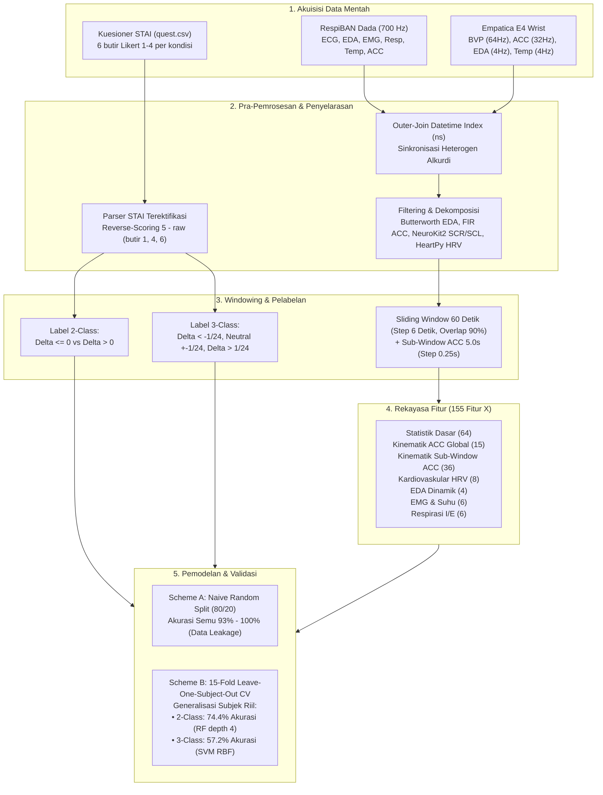

---
tags:
  - skripsi/index
  - skripsi/overview
  - map-of-content
aliases:
  - MOC Skripsi
  - Index Vault
  - Home
  - MOC - Skripsi Repository
---
# Peta Konsep & Indeks Vault Skripsi (MOC)

Selamat datang di basis pengetahuan riset skripsi:  
**Analisis Kelayakan Model Machine Learning Menggunakan Dataset WESAD untuk Deteksi State Anxiety: Upaya Simplifikasi Modalitas Menggunakan Wearable Tunggal**  
*Penyusun:* Rizqy Jauhary Atsaany (NIM: 235150300111038) — Teknik Komputer, Fakultas Ilmu Komputer, Universitas Brawijaya.

Vault ini mendokumentasikan implementasi komprehensif mulai dari pemrosesan sinyal mentah multisensor fisiologis, rekayasa fitur multi-domain, perumusan label psikologis kuesioner State-Trait Anxiety Inventory (STAI), penyelarasan metodologis terhadap literatur referensi (Alkurdi et al., 2025), hingga pelatihan dan evaluasi model Machine Learning berbasis validasi independen subjek (**Leave-One-Subject-Out / LOSO**).

---

## 🗂️ Struktur Folder & Modul Vault

```
_Obsidian Notes/
├── 📁 Research Notes/           # Catatan kronologis riset, audit kuesioner, & temuan perangkat
├── 📁 Model Specs/              # Spesifikasi teknis keluaran model, matriks konfusi, & benchmark
├── 📁 Pipelines & Methodology/  # Landasan metodologi pelabelan, pra-pemrosesan sinyal, & fitur
├── 📁 Proposals & Literature/   # Proposal skripsi, desain 5 skenario penelitian, & dataset WESAD
├── 📁 Scripts & Implementation/ # Dokumentasi modul skrip, evolusi kode 1st-6th try, & artefak
└── 📄 MOC - Skripsi Repository.md # Indeks utama vault (berkas ini)
```

---

## 🗺️ Peta Navigasi Catatan

### 1. 🔬 Catatan Riset & Log Perkembangan (`Research Notes/`)
Catatan kronologis perjalanan riset yang merekam temuan empiris, identifikasi anomali, perbaikan parser, dan eksperimen perangkat:
- [[2026-10-06 Research Note]] — *Temuan & Komparasi Pipeline Awal:* Analisis perbedaan semantik target WESAD stimulus vs STAI mandiri, justifikasi ambang batas heuristik $0{,}2$, dan peringatan klinis. *(Sebelumnya berjudul `Development Findings 1`).*
- [[2026-10-24 Research Note]] — *Audit Kuesioner STAI WESAD:* Penemuan aturan baku shortened STAI (6 butir) dari `wesad_readme.pdf`, implementasi *reverse-scoring* ($5 - \text{raw}$ pada butir 1, 4, 6), dan audit respons pada 15 subjek WESAD.
- [[2026-10-29 Research Note]] — *Integrasi Samsung Health Sensor SDK (Wear OS):* Investigasi akses tracker BVP PPG hijau dan ECG pada Galaxy Watch di `Deployment/test1/`, temuan runtime `PERMISSION_ERROR`, dan pembatasan otorisasi ekosistem ponsel.
- [[2026-11-05 Research Note]] — *Analisis Kontribusi Modalitas Sensor (4th/5th Try):* Pengungkapan bias dominasi fitur akselerometer (82 kolom), perumusan metode *decision ablation* per-jendela, dan eksperimen model *ACC-excluded*.
- [[2026-11-12 Research Note]] — *Penyelarasan Alkurdi & Benchmark 6th Try:* Integrasi outer-join datetime nanosekon Alkurdi, resolusi tuntas zero-inflation, perumusan formulasi 3-kelas kontinu ($\pm 1/24$) dan biner, serta evaluasi komparatif Scheme A (leakage) vs Scheme B (LOSO).
- [[2026-11-16 Research Note]] — *Kelayakan Modalitas Sensor Terpotong (Wrist-Only) & Ablasi Lengkap Pasangan Sensor Minimum 6th Try:* Eksperimen eliminasi sensor dada RespiBAN dan BVP (62 fitur) serta ablasi komparatif 3 kombinasi pasangan sensor pergelangan: Pair A (EDA+ACC: 56f), Pair B (EDA+TEMP: 20f), dan Pair C (ACC+TEMP: 48f). Membuktikan **urgensi absolut EDA** (tanpa EDA, model kolaps ke 54%–60%), efisiensi ekstrem Pair B (LDA 71.18% pada 20 fitur), dan retensi puncak Pair A (**73.11% Random Forest, retensi 99.18%**).

---

### 2. 📊 Spesifikasi Model & Evaluasi Benchmark (`Model Specs/`)
Dokumen referensi spesifikasi teknis model, parameter windowing, sebaran kohort, dan metrik evaluasi per subjek:
- [[Model Output Specs 5th Try]] — Spesifikasi lengkap model 5th try dengan window 60s/6s, standardisasi fitur in-fold, dimensi 154 fitur prediktif, analisis zero-inflation, dan hasil benchmark awal.
- [[Model Output Specs 6th Try 2-Class]] — Spesifikasi final klasifikasi biner terektifikasi ($\Delta \le 0$ vs $\Delta > 0$): 4.095 jendela, 155 fitur prediktif, eliminasi total zero-inflation (15/15 TSST positif), perbandingan Scheme A (96%–100%) vs Scheme B LOSO (**74.43% akurasi Random Forest depth 4, 74.14% XGBoost**), serta rincian 15 subjek.
- [[Model Output Specs 6th Try 2-Class Sliced Sensor]] — Spesifikasi model kelayakan smartwatch tunggal (hanya sensor pergelangan: ACC, EDA, TEMP; 62 fitur prediktif): evaluasi *shortfall* terhadap full-modality (Random Forest depth 4 mencapai **71.14% akurasi LOSO**, retensi performa **95.57%**, dan LDA meningkat **+4.96%**).
- [[Model Output Specs 6th Try 2-Class Minimum Sensor]] — Spesifikasi model eksperimen pasangan 2-sensor minimum: komparasi lengkap 3 pasangan (EDA+ACC 56f, EDA+TEMP 20f, dan ACC+TEMP 48f). Menunjukkan spesialisasi arsitektur (Tree unggul pada EDA+ACC **73.11%**, Linear/Kernel unggul pada EDA+TEMP **71.18%**) dan membuktikan peran krusial EDA sebagai pilar utama deteksi kecemasan.
- [[Model Output Specs 6th Try 3-Class]] — Spesifikasi final klasifikasi 3-kelas kontinu dengan ambang minimum unit kuesioner ($\pm 1/24 \approx \pm 0{,}04167$): 4.095 jendela, eliminasi celah ambang, distribusi kohort seimbang (27.1% C0, 25.1% C1, 47.8% C2), perbandingan Scheme A (93%–100%) vs Scheme B LOSO (**57.22% akurasi SVM RBF, 56.39% SVM Linear, 55.58% XGBoost**), dan matriks konfusi lengkap.

---

### 3. ⚙️ Metodologi, Pra-Pemrosesan, & Fitur (`Pipelines & Methodology/`)
Konsep ilmiah dan teknis pemrosesan sinyal dari data mentah hingga representasi tabular:
- [[Pipeline STAI User (v2_stai)]] — Konsep dan evolusi pipeline State Anxiety berbasis delta kuesioner STAI terhadap baseline individu, dari ambang heuristik $0{,}2$ hingga formulasi kontinu 6th try.
- [[Pipeline Forked (WESAD Protocol)]] — Konsep pipeline referensi berbasis kondisi stimulus protokol laboratorium WESAD (Baseline, Stress, Amusement).
- [[Perbandingan Pipeline STAI vs Forked]] — Komparasi mendalam perbedaan ground truth, metode windowing (tumbling 60s vs sliding 6s), filtering batas waktu, dan format target.
- [[Pra-Pemrosesan Sinyal & Filtering]] — Mekanisme pembersihan derau: Butterworth lowpass untuk EDA, FIR filter untuk akselerometer, dekomposisi Phasic/Tonic SCR/SCL via NeuroKit2, dan deteksi R-peaks HeartPy.
- [[Wrangling & Sinkronisasi Multimodal]] — Mekanisme sinkronisasi data sensor berfrekuensi heterogen (4 Hz hingga 700 Hz) menggunakan datetime index outer-join berbasis nanosekon.
- [[Katalog Fitur Fisiologis]] — Katalog lengkap taksonomi **155 fitur fisiologis prediktif** (statistik sinyal, kardiovaskular HRV, respirasi, EDA dinamik, suhu, dan 36 fitur kinetik sub-jendela akselerometer 5s/0.25s).

---

### 4. 📄 Landasan Riset, Proposal, & Dataset (`Proposals & Literature/`)
Landasan akademis, dokumen usulan skripsi, dan dokumentasi dataset sekunder:
- [[Proposal Skripsi Overview]] — Ringkasan usulan riset skripsi, rumusan masalah, latar belakang State Anxiety vs stres laboratorium, dan alur metodologi Bab 3 proposal.
- [[Rencana Riset & Pembangunan Sistem Deteksi Anxiety]] — Ringkasan komprehensif rencana riset, perancangan **5 skenario komparasi reduksi modalitas** (Skenario 1 s/d 5), protokol SCWT, dan roadmap deployment smartwatch.
- [[Dataset WESAD]] — Dokumentasi lengkap dataset sekunder WESAD: karakteristik 15 subjek sehat, spesifikasi perangkat RespiBAN dada dan Empatica E4 pergelangan, protokol eksperimen, dan kamus sampling rate.

---

### 5. 💻 Implementasi Skrip & Artefak (`Scripts & Implementation/`)
Dokumentasi teknis kode sumber dan artefak model tersimpan:
- [[Scripts Pipeline Evolution (1st to 6th Try)]] — **Dokumen sintesis utama** yang merangkum kronologi evolusi seluruh skrip di `Scripts/` (1st try, 2nd try, 3rd try, 4th try, 5th try, 6th try, Plan-b, dan Utils).
- [[Script v1]] — Implementasi teknis `Scripts/1st try/v1.ipynb` untuk klasifikasi 3-kelas protokol WESAD.
- [[Script v2_stai]] — Implementasi teknis `Scripts/1st try/v2_stai.ipynb` untuk klasifikasi biner STAI awal.
- [[Script 6th Try Pipeline (Alkurdi Alignment)]] — Dokumentasi komprehensif implementasi pipeline termutakhir (`Scripts/6th try/`): sinkronisasi outer-join nanosekon Alkurdi, rektifikasi STAI-6, 155 fitur prediktif, komparasi Scheme A vs Scheme B (LOSO), serta validasi kritis terhadap repositori upstream `_forked`.
- [[Forked Repository Overview]] — Ikhtisar repositori referensi upstream disertasi `anxietyFB` (Alkurdi et al.).
- [[Modul Library fb_code]] — Dokumentasi modul pustaka Python pada `_forked/fb_code/` (`feature_extraction.py`, `utils.py`, `ecg.py`, `respiration.py`).
- [[Data Artefacts Overview]] — Dokumentasi struktur penyimpanan data mentah, data bersih, dan dataset fitur teranotasi (`Data/5th try/`, `Data/6th try/`, `Data/Analysis/`, dan `_forked/data/`).
- [[Machine Learning Models & Evaluation]] — Analisis performa model ML (Random Forest, XGBoost, SVM, KNN, LDA), pembahasan kritis kebocoran data (*data leakage*), dan analisis inferensi subjek baru via LOSO.

---

## 🔄 Diagram Alir Data & Pemrosesan End-to-End



---

## 📌 Ringkasan Status Proyek & Tonggak Capaian

- [x] **Audit & Perbaikan Kuesioner STAI:** Menemukan dan menerapkan reverse-scoring pada shortened STAI 6 butir WESAD ([[2026-10-24 Research Note]]).
- [x] **Penyelarasan Metodologis Alkurdi:** Mengadopsi sensor clock outer join nanosekon dan ad-hoc scaling ([[2026-11-12 Research Note]]).
- [x] **Resolusi Zero-Inflation:** Berhasil mengatasi anomali pembacaan kuesioner lama sehingga 100% subjek (15/15) terbukti mengalami peningkatan kecemasan saat TSST.
- [x] **Pemodelan 3-Kelas Kontinu (6th Try):** Menghilangkan celah ambang $0{,}0$–$0{,}2$ dengan partisi $\pm \frac{1}{24}$, mencapai 57.2% LOSO akurasi dan 0.796 F1 kecemasan ([[Model Output Specs 6th Try 3-Class]]).
- [x] **Pemodelan 2-Kelas Terektifikasi (6th Try):** Membangun baseline biner seimbang (43.6% vs 56.4%), mencapai **74.43% akurasi LOSO** pada Random Forest (`max_depth=4`) ([[Model Output Specs 6th Try 2-Class]]).
- [x] **Analisis Kontribusi Modalitas Sensor:** Menyelesaikan eksperimen decision ablation dan model ACC-excluded ([[2026-11-05 Research Note]]).
- [x] **Eksplorasi Perangkat Wear OS:** Menguji Samsung Health Sensor SDK dan mendokumentasikan batasan izin runtime tracker BVP/ECG ([[2026-10-29 Research Note]]).
- [ ] **Pengujian Partisipan Primer (Skenario 4 & 5):** Pelaksanaan protokol induksi kognitif Stroop (SCWT) dan akuisisi data smartwatch komersial di lingkungan riil.
